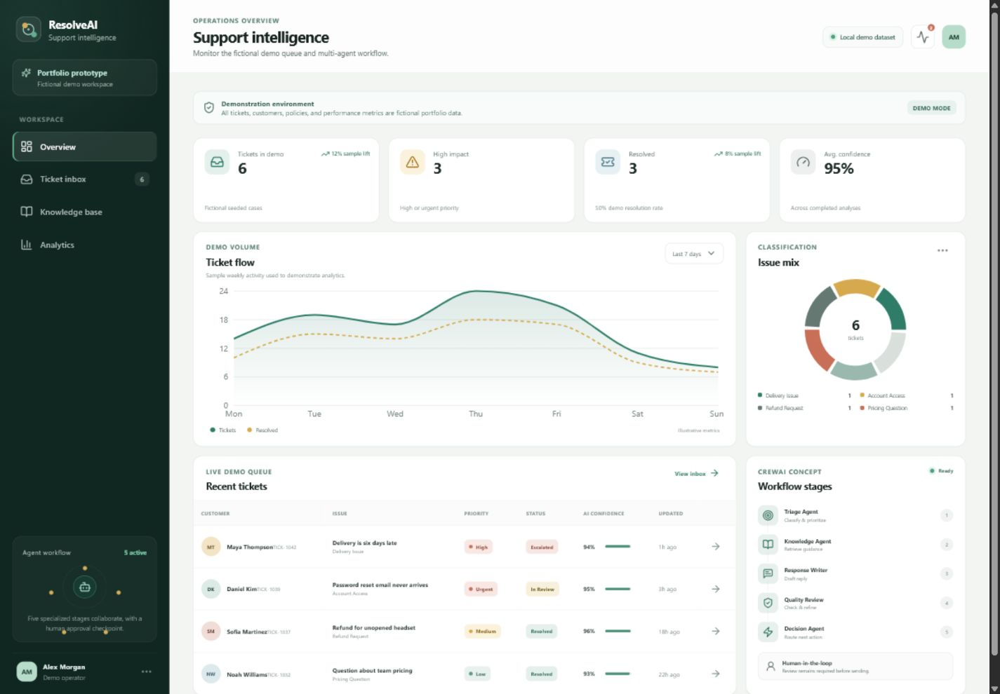

# ResolveAI — Customer Support Intelligence Prototype



ResolveAI is an **AI-powered customer support platform prototype** built to demonstrate multi-agent automation, ticket triage, response drafting, knowledge retrieval, quality review, and support workflow intelligence.

> **Portfolio disclosure:** this project is not presented as software used by a real company. The customers, tickets, policies, analytics, performance figures, operator profile, and product name in the demo are fictional. They exist to make the workflow easy to evaluate without exposing real support data.

## What the prototype demonstrates

- Structured ticket intake and a filterable support inbox
- Category, priority, urgency, and sentiment detection
- Knowledge-base retrieval with visible match evidence
- Draft response generation and a separately reviewed final response
- Confidence scores, escalation decisions, ticket status, and suggested next actions
- A five-stage CrewAI concept: Triage, Knowledge Base, Response Writer, Quality Review, and Decision agents
- Human-in-the-loop approval language throughout the interface
- Dashboard and analytics views built from clearly labeled sample metrics
- A no-key demo mode plus an optional Gemini/CrewAI execution path
- Responsive desktop and mobile layouts

## From CLI script to platform prototype

The original repository was a four-agent command-line workflow. It read five CSV tickets, searched one local Markdown policy file, drafted replies through Gemini, printed results, and saved them to `output/results.md`.

This version keeps that learning project intact while adding:

- `backend/` — a FastAPI service, data models, deterministic demo workflow, optional five-agent CrewAI adapter, analytics, CORS, error handling, and tests
- `frontend/` — a React + TypeScript + Vite operations dashboard with five product views and API fallback behavior
- `screenshots/` — three browser-captured portfolio images
- `render.yaml` and `frontend/vercel.json` — deployment configuration for Render and Vercel
- `.github/workflows/ci.yml` — automated API tests and a frontend production build

## Demo workflow


Demo mode is deterministic and requires no external API key. It returns the same evidence-rich result on every run, which makes the app reliable for portfolio review and screenshots. AI mode uses the optional CrewAI adapter and Gemini configuration; if enabled, the final decision is normalized into the same API model.

## API

| Method | Endpoint | Purpose |
| --- | --- | --- |
| `GET` | `/health` | Runtime and demo/AI mode status |
| `GET` | `/tickets` | List tickets; filter by status, priority, or category |
| `POST` | `/tickets` | Create a new ticket |
| `GET` | `/tickets/{id}` | Retrieve one ticket and its workflow evidence |
| `POST` | `/tickets/{id}/analyze` | Run triage, retrieval, drafting, review, and routing |
| `POST` | `/tickets/{id}/generate-response` | Generate or return the reviewed response |
| `GET` | `/knowledge-base` | List fictional demo articles |
| `GET` | `/analytics` | Return aggregate demonstration metrics |

Interactive API documentation is available at `/docs` while the backend is running.

## Tech stack

- **AI orchestration:** CrewAI with an optional Gemini LLM adapter
- **Backend:** Python 3.11, FastAPI, Pydantic, Uvicorn
- **Frontend:** React 18, TypeScript, Vite 6, Recharts, Lucide icons, custom responsive CSS
- **Testing:** Pytest, FastAPI TestClient, TypeScript compiler, Vite production build, browser QA
- **Deployment targets:** Vercel for the frontend and Render for the Python API

## Run locally

### 1. Backend

From the repository root:

```bash
python -m venv .venv
```

Activate the environment:

```bash
# Windows PowerShell
.venv\Scripts\Activate.ps1

# macOS/Linux
source .venv/bin/activate
```

Install the lightweight demo API and start it:

```bash
pip install -r backend/requirements.txt
cd backend
uvicorn app.main:app --reload --port 8000
```

The API is available at `http://localhost:8000`; demo mode is on by default.

### 2. Frontend

In a second terminal:

```bash
cd frontend
cp .env.example .env.local
npm install
npm run dev
```

On Windows PowerShell, replace the copy command with:

```powershell
Copy-Item .env.example .env.local
```

Open `http://localhost:5173`.

### 3. Tests and production build

```bash
# Backend, from backend/
python -m pytest -q

# Frontend, from frontend/
npm run build
```

## Environment variables

### Backend

Copy `backend/.env.example` to `backend/.env`.

| Variable | Required | Default | Description |
| --- | --- | --- | --- |
| `DEMO_MODE` | No | `true` | Uses the deterministic no-key workflow |
| `FALLBACK_ON_AI_ERROR` | No | `true` | Falls back to demo analysis if the external AI workflow fails |
| `GEMINI_API_KEY` | AI mode only | empty | Gemini credential; never expose it in the frontend |
| `GEMINI_MODEL` | AI mode only | `gemini/gemini-2.0-flash` | CrewAI model identifier |
| `CORS_ORIGINS` | Production | localhost | Comma-separated frontend origins |

To use the optional CrewAI path:

```bash
pip install -r backend/requirements-ai.txt
```

Then set `DEMO_MODE=false` and provide `GEMINI_API_KEY`. External model behavior and cost depend on the configured provider; demo mode remains the recommended portfolio setting.

### Frontend

| Variable | Required | Description |
| --- | --- | --- |
| `VITE_API_BASE_URL` | Recommended | Public base URL of the FastAPI service, without a trailing slash |

If the frontend cannot reach the API, it intentionally falls back to its bundled fictional dataset so the portfolio UI remains reviewable.

## Deployment

### Backend on Render

The root `render.yaml` contains the service configuration.

1. Create a Render Blueprint from this repository.
2. Keep `Root Directory` as `backend`.
3. Use `pip install -r requirements.txt` for the demo deployment.
4. Use `uvicorn app.main:app --host 0.0.0.0 --port $PORT` as the start command.
5. Set `DEMO_MODE=true` and set `CORS_ORIGINS` to the final Vercel origin.
6. Confirm that `https://<render-service>/health` returns `healthy`.

For AI mode, change the build command to `pip install -r requirements-ai.txt`, set `DEMO_MODE=false`, and add the Gemini variables as secrets.

### Frontend on Vercel

1. Import the repository and set the project root to `frontend`.
2. Framework preset: `Vite`.
3. Build command: `npm run build`.
4. Output directory: `dist`.
5. Set `VITE_API_BASE_URL` to the Render API URL.
6. Redeploy after updating the backend `CORS_ORIGINS` value with the Vercel URL.

The frontend uses hash-based navigation, so portfolio routes remain stable on static hosting.

## Portfolio screenshots

The repository includes browser-tested screenshots captured at a 1440 × 1000 desktop viewport:

- `screenshots/01-dashboard.png` — metrics, workflow chart, issue mix, recent tickets, and agent stages
- `screenshots/02-ticket-analysis.png` — ticket message, triage, sentiment, priority, reasoning, knowledge match, reviewed response, and agent activity
- `screenshots/03-analytics-or-knowledge-base.png` — illustrative resolution, priority, category, and agent-stage analytics

## Suggested Upwork portfolio description

> **AI-Powered Customer Support Platform Prototype**  
> I built a portfolio-grade customer support operations prototype using React, TypeScript, FastAPI, Python, and CrewAI. It demonstrates a five-stage multi-agent workflow for ticket triage, sentiment and urgency detection, knowledge-base retrieval, response drafting, quality review, escalation routing, and human approval. The project includes a responsive support inbox, evidence-rich ticket analysis, analytics dashboards, a documented REST API, automated tests, demo-mode fallback, and deployment configuration. All customers, policies, tickets, and metrics shown are fictional demonstration data; the project is not represented as a production system used by a real company.

## Current limitations and next steps

- Ticket persistence is intentionally in memory; a production implementation would add PostgreSQL and migrations.
- Demo authentication and role-based access are not included.
- AI mode requires an external provider key and should add rate limiting, tracing, prompt evaluation, and cost controls before any production use.
- The interface creates and reviews suggested responses; it does not send email or modify a real support system.
- Production use would require company-specific policy review, security testing, privacy controls, audit logs, accessibility testing, and human escalation procedures.

## Legacy CLI

The original root-level `main.py`, `agents.py`, `tasks.py`, `ticket_rules.py`, `data/`, and `knowledge/` files remain available as a simpler learning example. See the historical CLI flow by installing the root `requirements.txt`, configuring the root `.env`, and running `python main.py --limit 2`.

